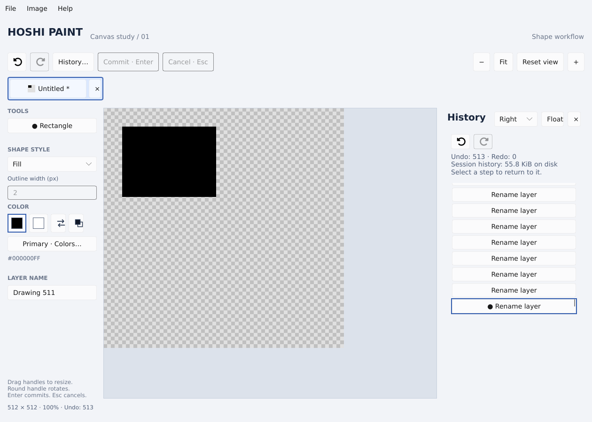

# Disk-backed undo history

Hoshi no longer drops the oldest action after 16 edits. Undo and redo retain the
entire document session as long as the scratch storage and required working memory
remain available. This follows Paint.NET's [documented history policy](https://www.getpaint.net/features.html): history length is limited by available disk space.
There is no configured action-count or history-byte ceiling.

Each document owns private temporary scratch storage. History records contain
compressed metadata and references to compressed, checksummed pixel tiles.
Unchanged tiles are written once and shared by later records. Older history states
do not keep their full pixel arrays alive in RAM; current and otherwise-live tiles
can be reused when restoring a state. Current-image pixels, saved comparisons and
restoration/encoding scratch still participate in the shared image-memory budget.
This is disk-backed history, not a promise that arbitrary dense images fit in RAM.
Restoring a completely different large state can temporarily require both the current
and target pixels to fit the working-memory budget; a failed restore keeps the current
image and timeline intact. Paging the active image itself is separate work.

## Editing and navigation

An edit becomes part of history only after its necessary records have been written
successfully. A failed write, including a full or unavailable disk, rejects that
edit and preserves the previously committed image, timeline and editable shape.
It does not silently delete older entries or discard redo to make room. Free disk
space and retry the action, or save and close other images to release their scratch
storage. Existing undo/redo records remain available when a new write cannot finish,
provided their backing data can still be read.

Undo, Redo and selecting a History row restore committed records. Selecting a distant
row loads the target state directly rather than replaying every intervening edit.
The floating and docked History panels share a virtualized list; ordinary pointer
movement does not rebuild all rows in a long timeline. The panel reports retained
undo/redo counts and scratch disk usage.

Editing after Undo starts a branch and discards its redo states, as in Paint.NET.
A successful branch compacts unreferenced history data to reclaim disk space.
Compaction failure retains the valid archive rather than risking its live records;
unreachable bytes may remain until a later successful reclamation or document close.
The live timeline is never sacrificed to satisfy an automatic history cap.

## Lifetime and storage failures

Scratch files are temporary session data and are removed when their document closes.
They are not embedded in `.hoshi` files. Opening a saved project starts a new history,
while the project preserves the image's current pixels, layers and settings.
Disk history is **not crash recovery or autosave** and is not intended to survive an
application restart. Scratch storage must remain accessible during the editing session.
Missing, damaged or unreadable records report an error and leave the displayed image
and current history position intact rather than loading incorrect pixels.

Core callers can choose a scratch directory before the document's first edit with
`Document::set_history_directory`. Otherwise the platform's temporary directory is
used. The desktop also accepts `HOSHI_HISTORY_DIR` before launching to select another
scratch volume. No administrator permission or separate service is needed. The directory must
be writable and have enough free space for the retained records and temporary
compaction work. The application cannot provide an infinite history after the disk
fills, nor guarantee availability when the underlying device fails.

## Validation

Integration tests retain more than a thousand edits, jump to the initial state,
redo pixel changes, and branch without a fixed step cap. Noisy image tiles verify
that metadata-only edits reuse disk blobs and that archived edits do not retain all
old pixel buffers. Independent expected values validate deep undo/redo of layer
names/properties, pixels, canvas dimensions and resolution. Scratch failure tests
preserve the image and active preview, and document-drop tests check cleanup.
Storage-unit tests cover partial writes, write/sync errors, record checksums and
transactional archive behavior. UI tests cover long-history row access and sharing
between floating and docked hosts.
