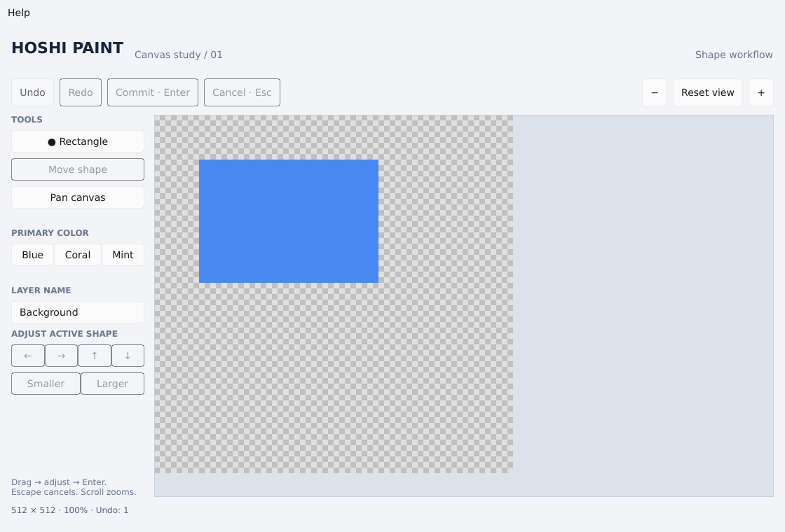

# Desktop canvas spike: results and next gates

## Decision

**Continue the Slint evaluation; production adoption remains undecided.** The
first desktop slice demonstrates that the Rust core/controller can drive a
software-rendered Slint canvas with temporary editable shapes. ARCH-1 remains
open for the GPU, real-device/input, accessibility, performance and iOS gates.

## Current-instance evidence

Validated on the managed Debian 13 x86_64 machine, Linux 6.18.57, five exposed
Xeon Platinum 8573C virtual CPUs, 32 GiB cgroup memory, four build jobs.
Rust 1.99.1; Slint 1.18.1; X.Org/Xvfb 21.1.16. These are development checks,
not reference-hardware release performance measurements.

| Check | Observed result |
| --- | --- |
| Existing core | 15 integration tests pass after the Rust upgrade |
| New UI-independent controller | 12 integration tests pass: lifecycle, coordinates/DPI math, pan/zoom, clipping, limits, color/name edits |
| Slint software rendering and input | One integration scenario passes with pixel assertions, Enter/Escape, undo/redo, text-field isolation, window focus policy and modal blocking |
| Actual Linux winit/software window | Xvfb smoke passes: show/run native event loop, dispatch synthetic input, commit shape, check displayed pixels, capture screenshot, exit |
| Build, format, lint | `cargo build -p hoshi-canvas-spike --locked`, rustfmt and workspace/all-target Clippy pass |
| Project-sync regression | Four Python tests pass |
| Rootless setup | Saved Debian package helper completes with signature/checksum verification; no host package installation |
| Windows/macOS spike CI | Configured in this PR; result must be checked after push |
| iOS | Not built or run; Apple-host checklist is a separate pending deliverable |

The framework events in the automated scenarios are synthetic. They test the
actual generated UI and controller, but not OS mouse capture, native keyboard
delivery or Pencil. The Xvfb run verifies desktop rendering, not manual usability.
It emits a nonfatal missing desktop-settings D-Bus warning in this minimal cloud
machine. The software renderer still draws and its pixel checks pass.

## Implementation scope

- 512×512 transparency checkerboard; pointer-anchored zoom and pan.
- Filled rectangle drag/release, adjustable position/size/color, commit/cancel.
- One exposed raster layer with name editing; undo/redo and canvas-scoped shortcuts.
- Top-level Help/About attribution, input-blocking modal, keyboard focus restoration.
- Click/no-drag produces no pixels. Lost activation cancels an unfinished drag;
  released editable shapes survive. Text editing does not run canvas shortcuts.

The experiment selects Slint's royalty-free 2.0 license with the required About
widget. Hoshi source remains MIT; dependency notices are separate. The initial
Rust 1.85.1 pin was upgraded deliberately: Slint requires at least 1.92 and the
current stable 1.99.1 resolves the locked graph. The small core Clippy change is
the new compiler's equivalent let-chain suggestion, not a behavior change.

## Remaining acceptance evidence

1. Manually test native pointer capture/release outside the window, keyboard
   navigation, native IME and focus transitions on all three desktop platforms.
2. Test X11/Wayland, mixed-monitor DPI and actual display changes. Coordinate
   unit tests and scale-1 screenshots do not replace those checks.
3. Test NVDA, VoiceOver and Orca. The canvas has an accessible label and controls
   use standard widgets, but this is not screen-reader acceptance evidence.
4. Measure release latency, idle CPU, copies/uploads, resizing and renderer
   recovery on named hardware. The current path recomposites/copies the full
   small image per refresh; performance targets have not been measured.
5. Evaluate the version-coupled wgpu texture path separately. This PR does not
   introduce GPU acceleration or prove device-loss handling.
6. Complete [Apple-host packaging and simulator/device checks](IOS_SPIKE_CHECKLIST.md).
   The current software-renderer manifest is a desktop manifest; iOS needs the
   official Skia path and platform packaging. No signing material is required in
   this repository or chat.

The next bounded implementation should improve shape handles/styles and the
render invalidation path while hardware/platform checks proceed. This spike
does not complete UI-1 or the v0.0.0 release acceptance scenario.
